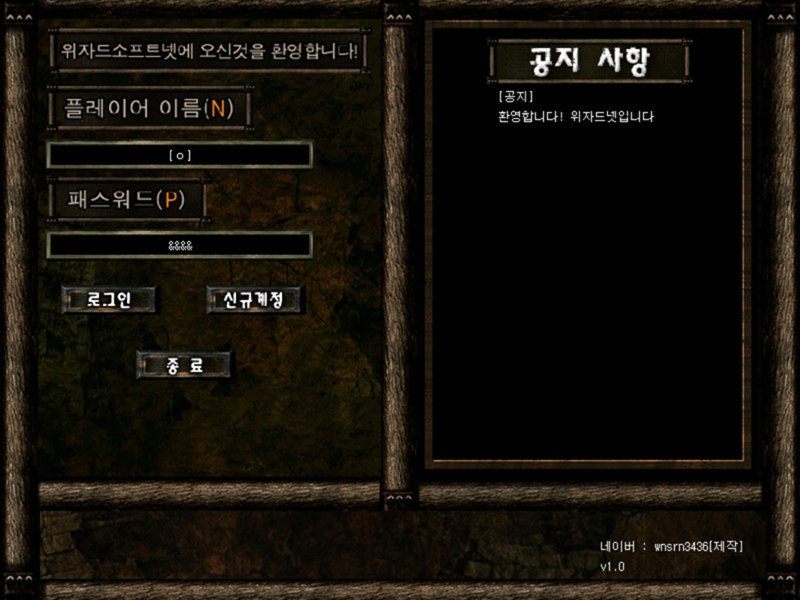

# 쥬라기원시전2 미니위자드넷

[English](README.md)

쥬라기원시전2의 배틀넷인 위자드넷이 서비스를 멈추자 직접 되살리려고 만든 클라이언트·서버 프로젝트다.

클라이언트는 원작 UI 그대로 로그인, 신규가입, 로비, 채팅 화면을 재현했다. 서버는 계정을 파일로 저장하고 접속자 목록을 중계하며 전체 채팅은 클라이언트끼리 브로드캐스트한다.

<p>
  
</p>


## 사용 방법

Releases에서 받아 압축을 풀면 `client` 와 `server` 폴더가 나온다.

서버를 먼저 켠다. `server/miniwizardnet-server.exe` 를 실행하면 접속을 받기 시작한다. 그다음 `client/miniwizardnet-client.exe` 를 실행해 가입하고 로그인하면 로비에 들어가 다른 접속자와 채팅할 수 있다.

접속할 서버 주소는 `client/Server_Infor.ini` 에서 바꾼다. 기본값은 `127.0.0.1` 이라 같은 컴퓨터에서 서버와 클라이언트를 함께 띄우면 바로 된다. 이 파일에는 서버 주소와 자기 표시 이름만 있고, 서버 이름과 로그인 화면에 뜨는 공지는 `server/Server_Infor.ini` 에서 고친다.


## 구현 원리

**메시지 ID와 슬롯으로 프로토콜을 짰다.** 주고받는 모든 통신에 번호를 붙이고, 각 번호마다 어떤 값이 몇 번째 자리에 들어가는지 정해뒀다. 예를 들어 2번은 로그인 요청으로 0번 자리에 아이디, 1번 자리에 비밀번호가 들어가고, 서버는 3번으로 답하면서 0번 자리에 통과 여부를 담는다. 전체 명세는 [docs/protocol.ko.md](docs/protocol.ko.md) 에 있다.

**직렬화는 구분자로 이어 붙이는 방식이다.** 게임메이커 내장 멀티플레이는 메시지 하나에 값 하나만 실을 수 있어서 그 위에 계층을 하나 얹었다. 가변 인자를 `^` 로 이어 보내면 받는 쪽에서 잘라 배열에 담는다.

```gml
// 보내는 쪽
for(i=2; string(argument[i])!='0'; i+=1)
{
  dit_wait = dit_wait+string(argument[i])+'^'
}
mplay_message_send_guaranteed(argument0, argument1, dit_wait)

// 받는 쪽
sk_dit_car(mplay_message_value(), argument0, '^')
```

**메시지 번호별로 스크립트를 나눴다.** 클라이언트에는 자기가 받는 번호(1, 3, 5, 6, 8, 10), 서버에는 서버가 받는 번호(0, 2, 4, 7, 9)의 처리 스크립트만 들어 있다. 어느 쪽이 무엇을 처리하는지 파일 목록만 봐도 드러난다.

**계정은 파일로 저장한다.** `_id_/id_0.txt` 처럼 번호를 붙인 텍스트 파일 하나가 계정 하나인데, 첫 줄이 아이디이고 둘째 줄이 비밀번호다. 가입하면 다음 번호의 파일을 만들고 목록을 다시 읽는다.


## 파일

| 경로 | 내용 |
|---|---|
| `source/client/` | 클라이언트 프로젝트 파일과 GmkSplitter로 분해한 텍스트 트리 |
| `source/server/` | 서버 프로젝트 파일과 GmkSplitter로 분해한 텍스트 트리 |
| `docs/protocol.ko.md` | 메시지 ID와 슬롯 명세 |
| `docs/screenshots/` | 스크린샷 |
| Releases | 클라이언트와 서버 실행 파일 |


## 크레딧

한글 출력 스크립트(`source/client/split/Scripts/한글_드로우/`, `source/server/split/Scripts/한글_드로우/`)는 게임메이커 커뮤니티의 김게맛(sodium031)님이 만든 것이다.


## 라이선스

zlib 라이선스다. 자세한 내용은 [LICENSE](LICENSE) 에 있다. 함께 들어 있는 것 중 다른 사람이 만든 라이브러리는 각자의 라이선스를 따른다.
